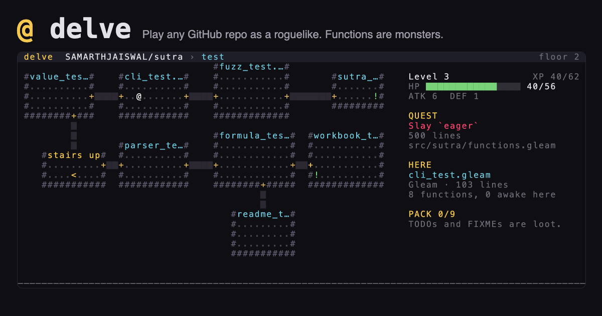

# @ delve

[](https://github.com/SAMARTHJAISWAL/delve/actions/workflows/ci.yml)
[](https://samarthjaiswal.github.io/delve/)
[](https://www.rust-lang.org)
[](LICENSE)

**Your codebase is a dungeon.** delve turns any git repository into a roguelike you can play:

| In your code | In the dungeon |
|---|---|
| a folder | a floor, with stairs down into its subfolders |
| a file | a room, sized by its length, with the file name on the door |
| a function | a monster: longer functions hit harder |
| the longest function in the repo | **the boss** |
| `TODO` / `FIXME` / `XXX` / `HACK` / `BUG` comments | loot |
| the people in `git log` | ghosts who whisper their real commit messages |

**[▶ Play any public GitHub repo in your browser](https://samarthjaiswal.github.io/delve/)**
There's nothing to install, and the code never leaves your browser.

[](https://samarthjaiswal.github.io/delve/)

## Play your own code

```sh
cargo install --git https://github.com/SAMARTHJAISWAL/delve delve-dungeon
cd your-project
delve
```

The terminal version reads every file in the repository, including private ones, and nothing leaves your machine. You need a terminal at least 96×30. When the run ends, delve prints a line you can share. This one is from the built-in bot's fastest win:

```
I delved into BurntSushi/ripgrep and defeated `_rg` (355 lines) at level 8 in 1317 turns, refactoring 57 functions on the way.
```

Want to know who the boss is before you go in?

```
$ delve stats
BurntSushi/ripgrep
  floors    33 folders, 5 deep
  rooms     106 source files, 56376 lines
  monsters  2540 functions
  loot      10 notes: 6 TODO, 4 FIXME, 0 HACK, 0 XXX, 0 BUG
  ghosts    107 committers
  boss      `_rg`, 355 lines, crates/core/flags/complete/rg.zsh:15
  elites    `context_code1` (280), `main` (276), `_rg_encodings` (274)
```

(Yes: ripgrep's biggest function is its zsh completion script.)

| Command | What it does |
|---|---|
| `delve [PATH]` | play the repository at PATH (default: the current one) |
| `delve stats [PATH]` | what the dungeon holds, without playing |
| `delve bot [PATH]` | let the built-in bot play 20 runs and report how it went, with its fastest win |
| `delve print [PATH]` | draw the first screen as text |
| `--seed N` | a specific dungeon: the same repo and seed always give the same game |
| `--daily` | today's dungeon, the same for everyone |

## How to play

| Key | Action |
|---|---|
| arrows, `hjkl` or `WASD` | move (`y` `u` `b` `n` for diagonals) |
| walk into a monster | attack |
| walk into a ghost `&` | hear one of their commit messages |
| `>` / `<` | go down into a subfolder / climb back up |
| `1`–`9` | use an item from your pack |
| `m` | the folder tree, with ☠ marking the boss's floor |
| `?` | help |

Monsters take after their language: a Rust function is a **c**rab, Python a **s**erpent, JavaScript a **g**oblin, TypeScript a **t**roll, Go a **g**opher, Java an **o**gre and C a **w**raith. Twenty-two languages are recognised.

Loot depends on the kind of comment:

| Comment | Item | Effect |
|---|---|---|
| `TODO` | potion `!` | heals you (you finally got to it) |
| `FIXME` | scroll `?` | reveals the floor |
| `XXX` | bomb `*` | damages everything nearby |
| `HACK` | blade `/` | +2 attack; it works, don't ask how |
| `BUG` | jar `%` | heals you, bites you, or teleports you |

A codebase with no TODOs at all leaves cups of coffee around instead.

## How it works

The engine lives in [`crates/core`](crates/core) and has no dependencies.

- **Reading code.**
  - [`analyze.rs`](crates/core/src/analyze.rs) finds function definitions and their extent with fast line-based heuristics for each language family: braces, indentation, or `do … end`.
  - It also finds tagged comments.
  - It isn't a parser; it doesn't need to be. It reads ripgrep's 56,000 lines in about 70 ms.
- **Building floors.**
  - [`dungeon.rs`](crates/core/src/dungeon.rs) lays out up to 12 rooms per folder: the biggest files, plus stairs to the biggest subfolders.
  - The way down to the boss's folder is always kept.
  - Rooms are joined by corridors that prefer to cross walls rather than run along them.
  - Tests check, across many seeds, that every monster, item and staircase is reachable.
- **Fair fights in any repo.**
  - A monster's strength comes from its function's length *rank* within the repository, not the raw line count. A repo of 2,000-line functions plays like one of 20-line functions.
  - The boss grows with the size of the repo.
- **Deterministic.** The same repository and seed always build the same dungeon and play out the same way, so runs can be compared.
- **One engine, two front ends.**
  - The terminal version uses [crossterm](https://crates.io/crates/crossterm).
  - The browser version is the same Rust compiled to a 250 KB WebAssembly module behind a tiny hand-written C interface (no wasm-bindgen).
  - Both copy the same 96×30 grid of coloured characters to the screen, so they look the same.

### Is it fair?

`delve bot` plays 20 runs with a simple bot. It walks to the nearest monster, item or unexplored stairs, drinks a TODO when hurt, and rests when no one is around. It rushes, so a careful person does better:

| Repository | Bot wins out of 20 | Average turns |
|---|---|---|
| BurntSushi/ripgrep | 17 | 2065 |
| pallets/flask | 6 | 1530 |

Most of the bot's deaths are to the boss. Clear a few floors and level up first.

## In the browser

[The web version](https://samarthjaiswal.github.io/delve/) asks GitHub's public API for the repository's file list and recent commits, then downloads up to 160 source files, spreading them across folders, straight from `raw.githubusercontent.com`.

- **Rate limit.** GitHub allows 60 API requests an hour per network without signing in, and each repository takes three. delve's own code is bundled, so it always plays.
- **Shareable links.** Add `?repo=owner/name` to share a dungeon. Add `&bot=1` to open it with the bot already playing.
- **Phones.** Touch controls appear on phones.

## Limitations

- **Function lengths are estimates.** Code generated inside strings, or unusual formatting, can confuse the line-based analysis.
- **The browser reads a sample.** Very large repositories are sampled at 160 files in the browser. The terminal version reads everything up to 512 KB per file.
- **Big folders are trimmed.** A folder with more than about 11 files or 4 subfolders keeps only the biggest ones on its floor. The sidebar says how many were left out.

## Building from source

```sh
cargo test --workspace                 # engine tests, including bot playthroughs
cargo run --release -p delve-dungeon   # play this repository
./web/build.sh                         # the browser version, into _site/
```

## License

[MIT](LICENSE)
